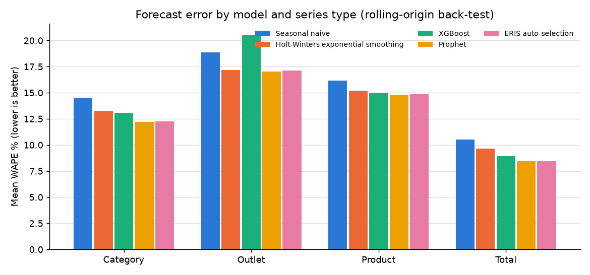
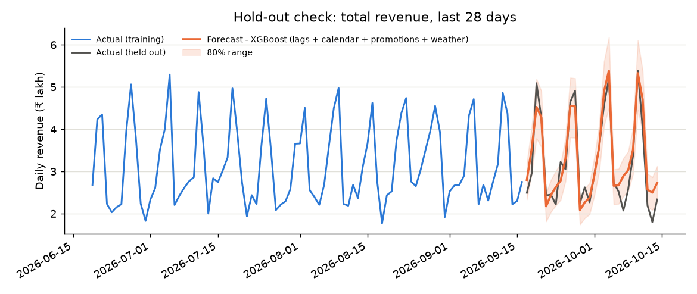

# Forecast model evaluation

Generated with `python -m app.evaluation` on the demo dataset: 25 series (total, outlets, menu categories, top dishes), 3 forecast origins each, 28-day horizon - 375 model runs. Every model is trained only on data before each origin.

## Mean WAPE (%) by series type

| model                              |   category |   outlet |   product |   total |   all series |
|:-----------------------------------|-----------:|---------:|----------:|--------:|-------------:|
| Seasonal naive                     |      14.49 |    18.85 |     16.18 |   10.53 |        15.88 |
| Holt-Winters exponential smoothing |      13.29 |    17.19 |     15.18 |    9.65 |        14.68 |
| XGBoost                            |      13.07 |    20.57 |     14.96 |    8.91 |        15.16 |
| Prophet                            |      12.23 |    17.04 |     14.81 |    8.46 |        14.07 |
| ERIS auto-selection                |      12.25 |    17.11 |     14.84 |    8.46 |        14.11 |

- **ERIS auto-selection: 14.1% WAPE** vs 15.9% for the seasonal-naive baseline (11% lower error).
- Best single model overall: **Prophet** (14.1%).
- 80% prediction-interval coverage of ERIS auto on the held-out windows: **84.8%** (target 80%).
- Dish-level series (portions per day) are noisier than revenue series that aggregate the whole menu, so their errors are naturally higher.

## All metrics (mean over series and origins)

| model                              |   wape |   smape |     mae |    rmse |   bias_pct |   seconds |
|:-----------------------------------|-------:|--------:|--------:|--------:|-----------:|----------:|
| Seasonal naive                     |  15.88 |   16.31 | 5384.63 | 6799.5  |      -1.04 |      0    |
| Holt-Winters exponential smoothing |  14.68 |   15    | 4911.79 | 6273.54 |      -1.28 |      0.15 |
| XGBoost                            |  15.16 |   15.42 | 5141.45 | 6504.26 |       1.77 |      0.25 |
| Prophet                            |  14.07 |   14.48 | 4561.32 | 5827.15 |      -2.41 |      0.27 |
| ERIS auto-selection                |  14.11 |   14.55 | 4602.91 | 5852.37 |      -2.07 |      1.52 |

sMAPE is symmetric MAPE; `seconds` is training + inference time per series and origin.

## How often each model was the most accurate

| model                              |   wins |
|:-----------------------------------|-------:|
| Prophet                            |     32 |
| XGBoost                            |     26 |
| Holt-Winters exponential smoothing |     15 |
| Seasonal naive                     |      2 |

## What auto-selection picked

| chosen                             |   times chosen |
|:-----------------------------------|---------------:|
| Prophet                            |             63 |
| XGBoost                            |              5 |
| Ensemble                           |              4 |
| Holt-Winters exponential smoothing |              3 |

## Method

- **WAPE** = Σ|actual − forecast| ÷ Σ actual. Unlike MAPE it is stable when some days have tiny sales.
- **Rolling origin**: origins are spaced one horizon apart, ending at the last day of data, so each test window is unseen by the model.
- **Auto-selection** reproduces production exactly: it back-tests the candidates on two consecutive 28-day folds at the end of its own training data, keeps Prophet unless a challenger (including the ensemble of the two best models) cuts WAPE by more than 10%, and refits the choice on all training data.
- **Features**: XGBoost and Prophet use calendar and festival features plus promotions, price index, weather and stockouts; planned promotions and climatological weather are known for the test window, future stockouts are not (set to zero).
- **Honest reading**: on this synthetic dataset Prophet is the strongest single model overall; the recursive XGBoost model is weaker than the seasonal-naive baseline on outlet series; XGBoost stays as a challenger because it wins on individual series.
